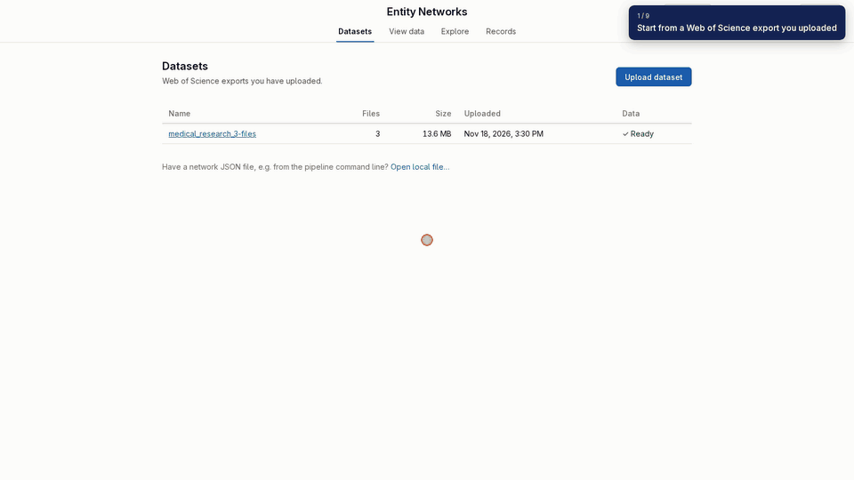

# Entity Networks

**See who works on what, and who works with whom.**
Entity Networks turns your Web of Science (WoS) search results into interactive maps
of people, institutions and topics. Export the records from WoS, upload the files, and
explore the network in your browser. No programming needed.

## Who it is for

- **Researchers in any field** who want to find potential co-workers, research groups,
  universities and institutions that work on topics close to their own.
- **WoS users** who want to go beyond a list of articles and see the connections
  behind it.
- **Librarians** who support research with WoS: map a department's collaborations,
  show which institutions or funders are active in a field, or help a researcher find
  partners.

## What you can do

1. **Upload a WoS export** (the `.xls` files WoS saves) as a dataset.
2. **See what's in it**: the data page lists the authors, institutions, countries,
   journals, funders, categories and research areas the records contain, with the most
   frequent values.
3. **Build a network** with one click:
   - *Co-authorship*: authors linked when they publish together.
   - *Institutions by shared keywords*: institutions linked when they publish on the
     same specific topics, even if they never wrote together. This is a good way to
     find partners you don't know yet.
   - *Custom*: choose the nodes (authors, institutions, countries, journals, funders,
     categories, research areas, articles), what links them (shared keywords,
     categories, funders, similar titles or abstracts, being on the same article), and
     how strict the match must be.
4. **Explore it**: zoom and pan, color by group, filter, search by name or by
   attribute (for example country or research area), keep only the strongest links,
   and click any node or link to see why it is there. Download the network as JSON to
   use it in other tools.

## Coming next

Today Entity Networks reads Web of Science exports. Support for **more repositories
and their formats** (other bibliographic databases and schemas) is in the working
plan.

---

The rest of this file is for developers: layout, setup, tests and the API.

## Layout

| Path | Contents |
|---|---|
| `backend/pipeline/` | WoS -> NetworkX -> network JSON (refactor of the original demo script) |
| `backend/app/` | FastAPI service: auth, datasets, network runs, worker |
| `backend/tests/` | pytest (pipeline golden snapshots, API tests) |
| `backend/scripts/` | smoke test, network comparison, synthetic test data |
| `frontend/` | React + TypeScript + Vite UI (Cytoscape.js graph explorer) |
| `deploy/` | Docker Compose, Caddyfile, backup script, deployment runbook |
| `infra/` | Terraform for the QA and PROD servers, `server.sh` to deploy them |
| `docs/` | Design notes, workflow, `openapi.json` and `network.schema.json` (both generated) |
| `data/wos/` | Raw WoS `.xls` exports (local only, git-ignored) |

## Status

- Step 1 (done): repository skeleton.
- Step 2 (done): pipeline refactored into `backend/pipeline/` with golden tests.
- Step 3 (done): network JSON contract as a Pydantic model (`backend/pipeline/schema.py`),
  enforced on every pipeline run; JSON Schema in `docs/network.schema.json`.
- Step 4 (done): FastAPI back-end - auth, dataset upload, network runs, worker,
  Alembic migrations, API tests against PostgreSQL.
- Step 5 (done): React UI - login, datasets, dataset data page, network explorer
  (see `frontend/README.md`).
- Step 6 (done): Docker Compose stack with Caddy, CI, browser tests, backups -
  see [`deploy/README.md`](deploy/README.md). QA and PROD servers: [`infra/README.md`](infra/README.md).
- Step 7: custom networks - choose the nodes (entity), the field that links
  them and the model that compares it (`backend/pipeline/custom.py`, see
  `docs/design-notes.md`).

## Where things are documented

| Topic | File |
|---|---|
| Day-to-day commands, local -> CI -> QA -> PROD | [`docs/workflow.md`](docs/workflow.md) |
| Development setup, pipeline, tests, smoke test, API | this file |
| Frontend commands, layout and tests | [`frontend/README.md`](frontend/README.md) |
| Compose stack, manual deploy, email, backups, limits | [`deploy/README.md`](deploy/README.md) |
| Terraform, `server.sh`, QA and PROD | [`infra/README.md`](infra/README.md) |
| Design decisions and their reasons | [`docs/design-notes.md`](docs/design-notes.md) |

## Setup

Python 3.14, the same version as the API image (`backend/Dockerfile`). The
constraints file pins every dependency to the versions CI and the image use:

    cd backend
    python3.14 -m venv .venv && .venv/bin/pip install -c constraints.txt -e '.[api,dev]'

## Pipeline only (no database)

From `backend/`:

    .venv/bin/python -m pipeline.cli ../data/wos -o out/

It writes one `network_<relation>.json` per relation into `out/`. Relations:
`author` (co-authorship) and `institution_keywords` (shared rare keywords). See
`.venv/bin/python -m pipeline.cli --help` for options.

## Back-end (local development)

PostgreSQL 16 on localhost:5432. On Fedora Silverblue the toolbox has no
podman, so create it **on the host** once (the toolbox shares the host network):

    podman run -d --name entitynet-db \
      -e POSTGRES_USER=entitynet -e POSTGRES_PASSWORD=entitynet -e POSTGRES_DB=entitynet \
      -p 127.0.0.1:5432:5432 -v entitynet-pgdata:/var/lib/postgresql/data \
      docker.io/library/postgres:16

Later sessions only need `podman start entitynet-db`.

Then, from `backend/` (copy `../.env.example` to `.env` to change settings),
create or upgrade the tables and start the API (on :8000, API docs at
`/api/docs`) and, in a second terminal, the worker:

    .venv/bin/alembic upgrade head
    COOKIE_SECURE=false .venv/bin/uvicorn app.main:app --reload
    .venv/bin/python -m app.worker

Run exactly one worker: see "Limits" in
[`deploy/README.md`](deploy/README.md#limits-and-rules-of-this-setup).

The UI runs separately with Vite: see [`frontend/README.md`](frontend/README.md).

### Accounts

Locally, registration is open (`ALLOW_REGISTRATION=true` by default). Servers
close it, so accounts are created with a command, which asks for the password:

    .venv/bin/python -m app.manage create-user you@example.org --admin
    .venv/bin/python -m app.manage set-password someone@example.org

Leave out `--admin` for a normal user. `set-password` also ends all of that
user's sessions. On a server the same commands run inside the `api` container:
see "Accounts on a server" in
[`deploy/README.md`](deploy/README.md#accounts-on-a-server).

## Tests

From `backend/`:

    .venv/bin/python -m pytest

- API tests use the database in `TEST_DATABASE_URL` (default
  `entitynet_test` on localhost, created automatically, wiped every session);
  they are skipped if PostgreSQL isn't reachable.
- Golden and real-data end-to-end tests need `data/wos/`; skipped otherwise.

CI (`.github/workflows/ci.yml`) also runs `ruff check .`, `ruff format --check .`,
`mypy` and `pip-audit`. Frontend tests: see [`frontend/README.md`](frontend/README.md#tests).

### Smoke test (running system)

`backend/scripts/smoke_test.py` checks a running API + worker + database over
HTTP: health, login, CSRF rejection, upload, network build, download (schema,
ETag), optional comparison with a golden file, cleanup, logout. It deletes what
it uploaded (unless `--keep`) and exits non-zero on the first failure. It runs
from the dev machine, never on a server.

Against the local API and worker from "Back-end" above, from `backend/`
(`--register` creates the account; it needs registration open):

    .venv/bin/python scripts/smoke_test.py --register \
        --email smoke@example.org --password 'some-long-password' \
        --golden tests/fixtures/golden/network_author.json

Options:

| Option | |
|---|---|
| `--base-url <url>` | default `http://127.0.0.1:8000` |
| `--email`, `--password` | the account; default from `SMOKE_EMAIL` / `SMOKE_PASSWORD` |
| `--register` | create the account first (needs `ALLOW_REGISTRATION=true`) |
| `--wos-dir <dir>` | the `.xls` files to upload; default `data/wos/`. Without the licensed data use `tests/fixtures` (synthetic) |
| `--golden <file>` | the network must equal this JSON (only with `data/wos/`) |
| `--relation` | `author` (default) or `institution_keywords` |
| `--proxy` | also check Caddy in front: UI served, deep links, security headers, compression |
| `--insecure` / `--ca-cert <file>` | for Caddy's local certificate |
| `--keep` | don't delete the dataset at the end |

Against the local Compose stack: see "Run it locally" in
[`deploy/README.md`](deploy/README.md#run-it-locally-or-in-ci). Against a server,
where registration is off, create the account there first (see
[Accounts](#accounts)) and pass it in the environment, so the password isn't in
the command line:

    SMOKE_EMAIL=smoke@example.org SMOKE_PASSWORD=<password> .venv/bin/python scripts/smoke_test.py \
        --base-url https://<server address> --proxy --wos-dir tests/fixtures

**Crash recovery** is checked by hand, locally: queue a run, `kill -9` the
worker while the run is `running`, start a new worker. It logs "Recovered 1
orphaned run(s)" and finishes the run. To find the worker's PID, don't use
`pgrep -f 'app.worker'` from a script: it also matches the script's own shell.

## API

| Method | Path | |
|---|---|---|
| POST | `/api/auth/register`, `/api/auth/login`, `/api/auth/logout` | session cookie + CSRF token |
| GET | `/api/auth/me` | current user + CSRF token |
| POST | `/api/auth/password-reset/request`, `/api/auth/password-reset/confirm` | email a one-time link / set the new password |
| POST/GET | `/api/datasets` | upload WoS `.xls` files (multipart: `name`, `files`) / list |
| GET/DELETE | `/api/datasets/{id}` | |
| GET | `/api/datasets/{id}/profile` | overview of the uploaded data (computed by the worker) |
| GET | `/api/datasets/{id}/network-options` | what a custom network can be built from in this dataset |
| POST/GET | `/api/runs` | queue `{dataset_id, relation, params?}` / list. `relation`: `author`, `institution_keywords` or `custom` (params `entity`, `link`, `model`, see `docs/openapi.json`) |
| GET/DELETE | `/api/runs/{id}` | status: queued, running, succeeded, failed |
| GET | `/api/runs/{id}/network`, `/api/runs/{id}/export` | network JSON (ETag) / as download |
| GET | `/api/health` | |

Every POST/DELETE made with a session must send the `X-CSRF-Token` header
(value from login/me or the `entitynet_csrf` cookie). Register, login and
password reset don't need it. The full API is in `docs/openapi.json`
(generated; the `/api-change` skill regenerates it).

## Data

Place WoS exports (`.xls`, sheet `savedrecs`) in `data/wos/`. They are not
committed because they are licensed source data.
